  <a href="https://raoufabedini.dev"><b>Portfolio</b></a> &nbsp;·&nbsp;
  <a href="https://raoufabedini.dev/resume">Résumé</a> &nbsp;·&nbsp;
  <a href="https://raoufabedini.dev/write-ups">Write-ups</a> &nbsp;·&nbsp;
  <a href="https://orcid.org/0009-0000-6214-258X">ORCID</a> &nbsp;·&nbsp;
  <a href="https://www.linkedin.com/in/mohammad-raouf-abedini-885a9226a/">LinkedIn</a> &nbsp;·&nbsp;
  <a href="mailto:raoof.r12@gmail.com">Email</a>

I work on keeping tool-using AI agents safe. I build host-side controls for what an agent is permitted to do, then run matched-control experiments against live models to find out whether those controls change anything. When they change nothing, that goes in the write-up too.

Before this I spent seven years in security operations and engineering. I have five sole-author preprints, two coordinated vendor disclosures (Microsoft and Apple), and I evaluated Claude for exploitable code and guardrail circumvention in Anthropic's safety-evaluation program through Alignerr.

## The result I lead with

[**Project Simurgh**](https://github.com/Raoof128/Project-Simurgh) is an open-source authorization and containment prototype for AI agents. I am its sole author. In October 2026 I ran a transfer study: 24 tasks, two trials each, three matched controls (credential-only, composed, deny-all) and two models, 288 replayed branches in total. Protocol to published package took three days.

On Meta Llama-3.2-3B the composed host controls cut restricted-state trials with new effects from 17/24 to 0/24, kept 23/24 useful completions and blocked no valid proposal. On OpenAI gpt-6-luna the baseline was already 0/24, so the study reports no incremental protection there.

More from the same project:

- **Classifier coverage.** I captured a live Llama Guard 4 12B input classifier over a 180-case set and produced containment evidence for all 138 malicious cases it missed. 120 of them were downstream injections that an input-only classifier cannot see. This is a coverage claim, and it does not rank classifiers.
- **AgentDojo.** A live Llama-3.3-70B agent's targeted attack success went from 9/140 to 0/140 over pre-registered injections in the workspace suite. The full four-suite deterministic run scored 0/949 attack success with 949/949 unattacked utility. Both are scoped as small experiments.
- **A defect I found in my own integration.** An eight-case OpenAI Responses API workflow exposed a role-placement error (8/8 declined). I kept the original traces. A frozen developer-role correction completed 2/3 authorized workflows and declined 5/5 restricted ones. One refusal is still open.
- **Built to be re-run.** Ed25519-signed evidence archives replay offline in one command. 39 Lean 4 proofs sit behind a gate that fails on any unproven `sorry`. 5,171 tests passed in the 19 Oct 2026 smoke run.
- **Self-audit.** I audited 919 of the project's own documents and published all 141 dated findings in the README, including overstatements in my earlier closeouts.

Software DOI [10.5281/zenodo.21737792](https://doi.org/10.5281/zenodo.21737792) · 93 releases · [case study](https://raoufabedini.dev/projects/project-simurgh)

## Preprints

All sole-author, all on Zenodo.

| Paper | Finding | DOI |
|:--|:--|:--|
| **The Invisible Window** Screen-capture evasion in WebRTC proctoring | Documented display-affinity APIs on Windows and macOS let a window stay visible on the monitor while contributing zero pixels to screen capture: 100% evasion in every tested lab configuration, including macOS 26. Disclosed to Microsoft MSRC (Feb 2026) and Apple Product Security (Mar 2026) before publication. Both classified the behavior as by design. | [20376495](https://doi.org/10.5281/zenodo.20376495) |
| **Aion-BibleQA** Retrieval and citation faithfulness in a RAG system | A 40-question benchmark for retrieval quality, citation support and false-premise robustness: R@5 of 0.941, mean citation support of 0.978, zero unsupported citations and 6/6 false-premise refusals. | [20522874](https://doi.org/10.5281/zenodo.20522874) |
| **Banking Shield** Machine-checked absence claims | Machine-checked proofs that privacy-sensitive values never reach AI-generated explanations. Five-tester dry run, zero leaks. | [20675513](https://doi.org/10.5281/zenodo.20675513) |
| **Simurgh device-integrity proofs** | Privacy-preserving device integrity proofs for high-stakes sessions. | [20374849](https://doi.org/10.5281/zenodo.20374849) |
| **Student-society event pilot** | 31 consented sessions. Ballot choices excluded from records. HMAC-chained audit logs. | [20549736](https://doi.org/10.5281/zenodo.20549736) |

The Invisible Window proof-of-concept code is withheld on dual-use grounds. The [public record](https://github.com/Raoof128/invisible-window-research) and the [case study](https://raoufabedini.dev/projects/invisible-window-research) cover the finding, its limits, the disclosure and the citation.

## Tools I ship

| Project | Built with | What it does |
|:--|:--|:--|
| [**SentinelSSH**](https://github.com/Raoof128/sentinel-ssh) | Rust · MCP | Gives AI agents policy-scoped, read-only inspection of Linux hosts through 17 typed tools and no shell. |
| [**Project Zurvan**](https://github.com/Raoof128/Project-Zurvan) | Python · Rust · SQLite | Local-first knowledge engine that serves claims and decisions to agents over MCP. 4,109 tests. |
| [**Gmail MCP**](https://github.com/Raoof128/gmail-mcp) | TypeScript · Cloudflare Workers | Multi-account Gmail server with server-enforced allow, ask or deny policy and attachment transfers through a local companion. Pre-release. |
| [**Mehr Guard**](https://github.com/Raoof128/MehrGuard) | Kotlin Multiplatform | Offline QR and URL phishing scanner. Ensemble ML plus 25 heuristics at 87% F1 in under 5 ms, with a 19-scenario red-team mode. |
| [**SentinelFlow**](https://github.com/Raoof128/SentinelFlow) | C++17 · libpcap | Network intrusion detection at 500,000+ packets/sec in a synthetic single-thread benchmark. |
| [**NanoMatch**](https://github.com/Raoof128/NanoMatch) | C++20 | Price-time matching engine. The repository reports 9.29M mixed add/cancel operations per second, single thread, synthetic load. |
| [**Syllabus-Sync**](https://syllabus-sync.app) | Next.js · TypeScript · Postgres | Macquarie University Incubator startup that converts university syllabi into structured data. I am a cofounder and led the security backend: WebAuthn passkeys, TOTP MFA, row-level security and tamper-resistant audit logging. 1,399 tests across 167 files. |

Languages I work in: Python, TypeScript, C, C++17/20, Rust, Kotlin, Lean 4, SQL and Bash.

## Background

- **AI Safety Evaluator (Claude)**, Alignerr, Jan to Mar 2026. Anthropic safety-evaluation program. Stress-tested Claude's safety guardrails, assessed outputs for exploitable code and harmful patterns, analyzed circumvention methods and delivered rubric-based findings.
- **Cofounder**, Syllabus-Sync, May 2026 to present.
- **Security Engineer and Full-Stack Developer**, freelance, Jan 2024 to present.
- **IT Manager and Security Operations**, Iran Pharmacy, Aug 2019 to Jan 2024. Investigated unauthorized-access incidents and built detection workflows that cut manual triage by about 30%.
- **Bachelor of Cyber Security**, Macquarie University, expected Jun 2027. The final session is fully online.

 

  Security reports: <a href="https://raoufabedini.dev/.well-known/security.txt">security.txt</a>

